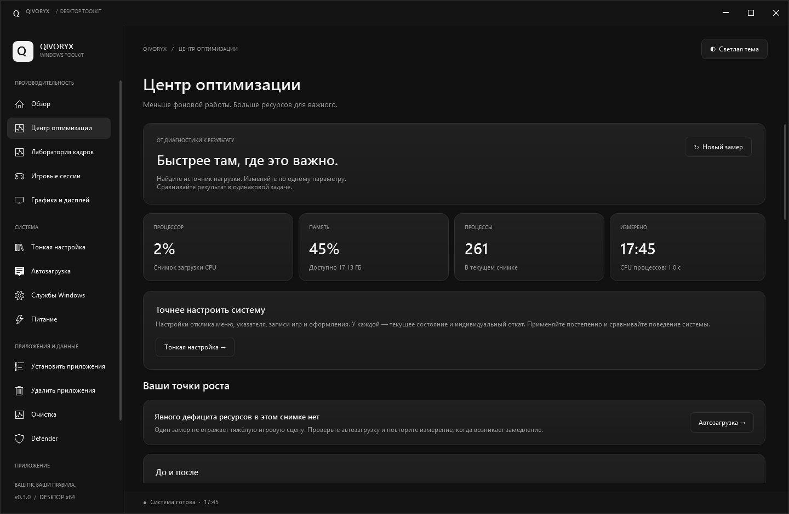
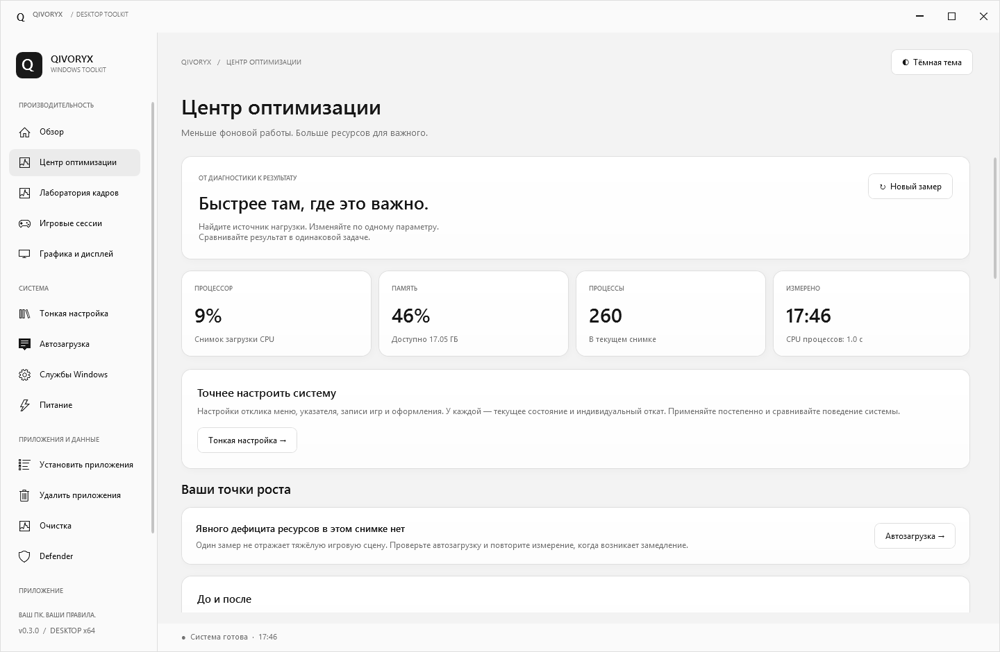
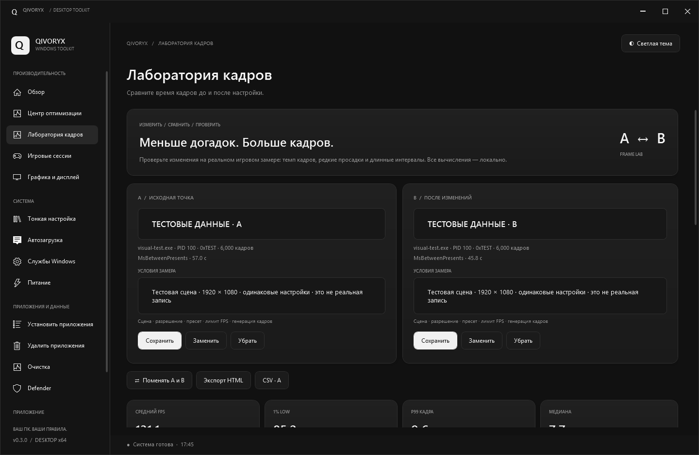
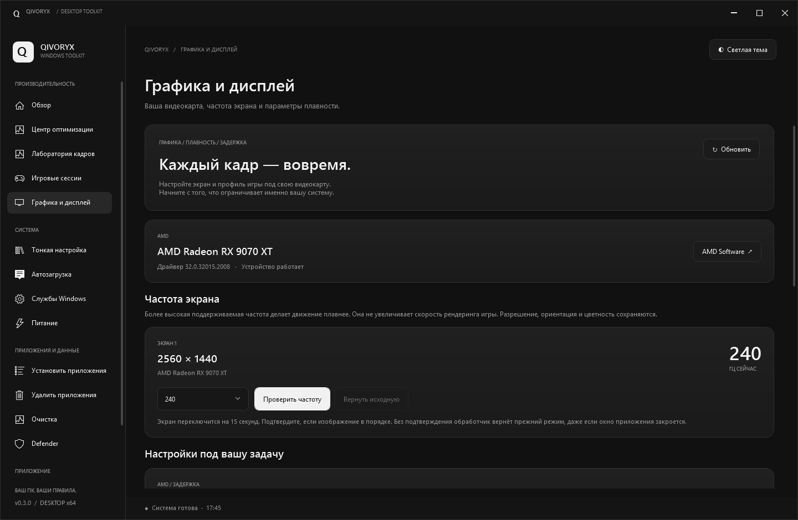
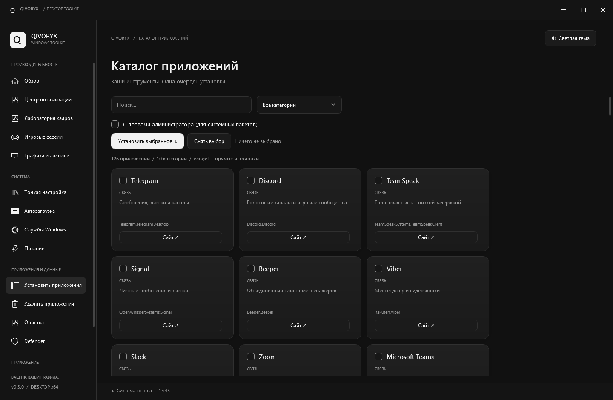
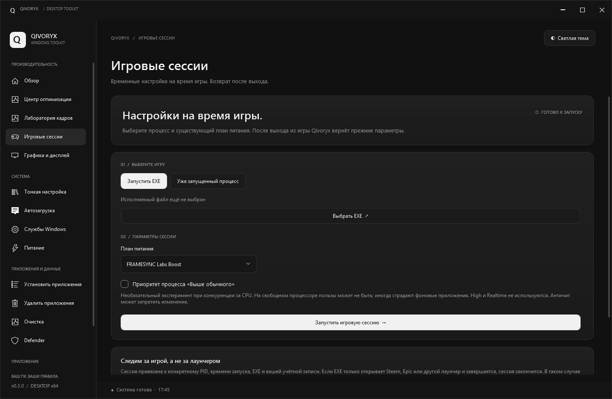
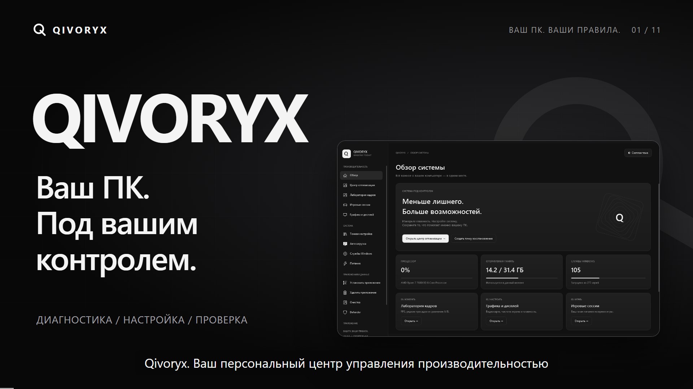

<div align="center">


# Qivoryx

**Ваш ПК. Под вашим контролем.**

Диагностика, настройка Windows и проверка результата — в одном приложении.


[**Скачать приложение**](https://github.com/Roddenzz/Qivoryx/releases/latest) · [Возможности](#возможности) · [Установка](#установка) · [Сборка](#сборка-из-исходников) · [Видео](#видеообзор)



</div>

Qivoryx — нативное приложение для настольных ПК с Windows 10/11 x64. Оно помогает найти источник нагрузки, управлять фоновыми программами, настроить питание и дисплей, установить нужное ПО и сравнить игровые замеры до и после изменений.

Интерфейс на русском языке: тёмная и светлая монохромные темы, плавные переходы, единые элементы управления, журнал действий и уведомления. Доступны **портативная версия и установщик**; устанавливать .NET для запуска приложения не нужно.

## Скачать

| Файл в Releases | Для чего нужен |
| --- | --- |
| [**Qivoryx-0.3.0-Portable-x64.zip**](https://github.com/Roddenzz/Qivoryx/releases/download/v0.3.0/Qivoryx-0.3.0-Portable-x64.zip) | Распаковать полностью и запустить `Qivoryx.exe`. Можно перенести вместе с данными. |
| [**Qivoryx-0.3.0-Setup-x64.exe**](https://github.com/Roddenzz/Qivoryx/releases/download/v0.3.0/Qivoryx-0.3.0-Setup-x64.exe) | Установить приложение для текущего пользователя с ярлыками и деинсталлятором. |
| [SHA256.json](https://github.com/Roddenzz/Qivoryx/releases/download/v0.3.0/SHA256.json) | Проверить целостность установщика и portable-архива. |
| [Видеообзор, русский, Full HD](https://github.com/Roddenzz/Qivoryx/releases/download/v0.3.0/Qivoryx-Presentation-RU-Arseniy-1080p.mp4) | Познакомиться с интерфейсом и основными инструментами за 3 минуты 6 секунд. |

**Для обычного использования достаточно ZIP или EXE.** Автоматические архивы GitHub «Source code» содержат исходники и не заменяют готовые сборки.

## Возможности

| Раздел | Что можно сделать |
| --- | --- |
| **Обзор системы** | Посмотреть CPU, память, диски, время работы, сведения о службах и состоянии защиты. |
| **Центр оптимизации** | Получить снимок нагрузки, отсортировать процессы по CPU и памяти, сравнить снимки, настроить визуальные эффекты, запустить обслуживание дисков и компонентов Windows. |
| **Лаборатория кадров** | Импортировать CSV PresentMon, выбрать процесс и swapchain, сравнить A/B: средний FPS, 1% low, P95/P99 и график времени кадра. Сохранить замеры и экспортировать HTML/CSV. |
| **Игровые сессии** | Временно включить выбранный план питания, при необходимости задать AboveNormal для процесса, вернуть параметры после завершения сессии. |
| **Графика и дисплей** | Посмотреть GPU и драйверы, проверить рекомендации AMD/NVIDIA, изменить поддерживаемую частоту дисплея с временным предпросмотром и автоматическим возвратом без подтверждения. |
| **Тонкая настройка** | Изменить задержку меню, ускорение указателя, встроенную запись игр и прозрачность Windows. Для каждого поддерживаемого изменения доступен индивидуальный откат. |
| **Автозагрузка** | Найти записи Run и папок Startup, увидеть исходную команду, отключить запись с резервной копией и восстановить её. |
| **Службы Windows** | Найти службу по имени и описанию, посмотреть рекомендации и нагрузку процесса-хоста, изменить состояние или тип запуска. Критические службы защищены от изменений. |
| **Питание ПК** | Настроить 10 параметров: CPU, Boost, EPP, парковку, охлаждение, PCIe, USB, диск и экран. У каждого есть описание. Изменения применяются к копии плана. |
| **Установка приложений** | Выбрать программы из 126 записей в 10 категориях. Очередь использует winget; резервные прямые загрузки проверяются по SHA-256 перед запуском. |
| **Удаление приложений** | Просмотреть Win32 и Appx текущего пользователя, запустить зарегистрированный деинсталлятор. Для Edge используется отдельный штатный механизм, доступность зависит от Windows. |
| **Очистка** | Сначала проанализировать TEMP, дампы и кэш, затем выбрать категории. Занятые файлы и ссылки пропускаются; документы и загрузки не затрагиваются. |
| **Windows Defender** | Посмотреть состояние защиты; отдельная интеграция запускает внешний инструмент из поставки после подтверждения. Подробности и ограничения — в [руководстве](docs/USER-GUIDE.md#возможности). |
| **Журнал и настройки** | Просмотреть результаты действий и резервные копии, выполнить поддерживаемое восстановление, переключить тему. |

Подробности поведения каждого инструмента, формулы, состав каталога и границы восстановления описаны в [руководстве пользователя](docs/USER-GUIDE.md).

### Сначала измерить, затем настроить

Qivoryx не обещает универсальный прирост FPS. Результат зависит от оборудования, игры, драйвера и исходной нагрузки. Чтобы оценить изменение, повторите одинаковую игровую сцену несколько раз и сравните реальные CSV в лаборатории кадров. Встроенного захвата PresentMon нет: запись выполняется внешним инструментом.

## Интерфейс

<table>
  <tr>
    <td><br><b>Тёмная тема</b></td>
    <td><br><b>Светлая тема</b></td>
  </tr>
  <tr>
    <td><br><b>Лаборатория кадров</b> · демонстрационные данные</td>
    <td><br><b>Графика и дисплей</b></td>
  </tr>
  <tr>
    <td><br><b>Каталог приложений</b></td>
    <td><br><b>Игровые сессии</b></td>
  </tr>
</table>

## Установка

### Портативная версия

1. Скачайте `Qivoryx-0.3.0-Portable-x64.zip` из [Releases](https://github.com/Roddenzz/Qivoryx/releases/latest).
2. Распакуйте **весь архив** в доступную для записи папку.
3. Запустите `Qivoryx.exe`.

Не переносите EXE отдельно: соседние файлы и модули нужны для работы. Файл `portable.flag` включает переносимый режим; личные данные сохраняются в папке `Data` рядом с EXE. Для внешнего BAT-инструмента выбирайте путь без скобок и `!`.

### Установщик

1. Скачайте и запустите `Qivoryx-0.3.0-Setup-x64.exe`.
2. Выберите параметры ярлыков и завершите установку.
3. Запустите Qivoryx из меню «Пуск».

Установка выполняется в `%LOCALAPPDATA%\Programs\Qivoryx`, данные — в `%LOCALAPPDATA%\Qivoryx`. Удалить приложение можно через Параметры Windows или `Uninstall.exe`. Установщик не переносит данные из portable-папки автоматически.

### Требования

- Windows 10 или 11, **x64**; основной сценарий — настольный ПК.
- В portable-сборке среда .NET 8 уже включена. Установщик использует .NET Framework 4.8.
- Для просмотра большинства сведений администратор не нужен; системные изменения могут запросить UAC.
- Интернет нужен для загрузки программ. При отсутствии winget используются предусмотренные каталогом прямые источники.
- Сборки не подписаны коммерческим сертификатом.

Проверка загруженных файлов в PowerShell:

```powershell
Get-FileHash .\Qivoryx-0.3.0-Portable-x64.zip -Algorithm SHA256
Get-FileHash .\Qivoryx-0.3.0-Setup-x64.exe -Algorithm SHA256
```

Сравните значения с `SHA256.json` того же релиза.

## Изменения и восстановление

Поддерживаемые настройки сохраняют исходное состояние, а журнал показывает результат операции. Службы, автозагрузка, визуальные параметры и питание имеют свои механизмы возврата. При восстановлении учитываются изменения, сделанные другими программами.

Это не полный образ Windows: очистка файлов, удаление программ, обслуживание компонентов и внешний инструмент удаления защиты не имеют общего автоматического отката. Перед такими действиями подготовьте резервную копию системы. Удаление Defender также затрагивает другие компоненты защиты и запускается **видимо**, с диалогами внешнего инструмента.

Некоторые параметры зависят от оборудования и сборки Windows. Защищённые Appx не удаляются вручную, Edge может быть недоступен для удаления, WebView2 сохраняется. Нагрузка общей службы относится к её процессу-хосту. После аварийного завершения игровой сессии восстановление временных параметров выполняется при следующем запуске Qivoryx.

### Где хранятся данные

| Данные | Расположение |
| --- | --- |
| Основные данные portable | `Data` рядом с `Qivoryx.exe` |
| Основные данные установленной версии | `%LOCALAPPDATA%\Qivoryx` |
| Восстановление игровых сессий, включая portable | `%LOCALAPPDATA%\Qivoryx\Sessions`, защита DPAPI |
| Общие резервные копии автозагрузки | `%PROGRAMDATA%\Qivoryx\StartupMachine`, защищённые ACL |

Системные резервные копии привязаны к пользователю и компьютеру; перенос portable-папки не переносит их на другой ПК. Каталог ПО обращается к winget и сайтам издателей.

## Сборка из исходников

### Приложение

Требуются Windows x64 и [.NET SDK 8](https://dotnet.microsoft.com/download/dotnet/8.0). Для упаковки — PowerShell 7, CLI `7z` и .NET Framework 4.8.

```powershell
git clone https://github.com/Roddenzz/Qivoryx.git
cd Qivoryx
dotnet build .\Tweaker\Tweaker.csproj -c Release
```

Самодостаточная сборка без установщика:

```powershell
dotnet publish .\Tweaker\Tweaker.csproj -c Release -r win-x64 --self-contained true `
  -p:PublishSingleFile=true -p:EnableCompressionInSingleFile=true `
  -p:IncludeNativeLibrariesForSelfExtract=true -p:DebugType=None `
  -o .\dist\Qivoryx-Portable
Copy-Item .\docs\USER-GUIDE.md .\dist\Qivoryx-Portable\README.md
Set-Content .\dist\Qivoryx-Portable\portable.flag 'Qivoryx portable mode'
```

Для **полной упаковки ZIP и EXE**, соответствующей поставке 0.3.0, разместите локальную зависимость `DefenderKiller.7z` рядом с `build.ps1` и выполните:

```powershell
pwsh -File .\build.ps1
```

Этот внешний архив не хранится в Git. Без него приложение компилируется и работает, но интеграция внешнего инструмента недоступна. Готовые ZIP и EXE в Releases уже содержат комплект поставки. `build.ps1` сам компилирует установщик и деинсталлятор, создаёт архив и `dist\SHA256.json`. Данные из portable-папки `Data` в поставку не включаются.

### Проверки

```powershell
dotnet run --project .\tests\FrameLabTests\FrameLabTests.csproj -c Release
dotnet run --project .\tests\GameSessions\GameSessions.csproj -c Release
pwsh -File .\tests\backend.ps1
pwsh -File .\tests\startup.ps1
pwsh -File .\tests\performance.ps1
pwsh -File .\tests\playbook.ps1
pwsh -File .\tests\gpu.ps1
```

Тесты используют изолированные данные и подменяют операции изменения системных настроек. Тесты автозагрузки создают временный ключ реестра. Удаление Defender/Edge, удаление реальных программ, очистка пользовательских файлов и системные изменения не запускаются для проверки на основном ПК.

Read-only проверка интерфейса: `Qivoryx.exe --smoke`. Она читает сведения Windows и сохраняет снимки 15 страниц в обеих темах в `artifacts\ui`. Проверка распаковки установщика без установки: `Qivoryx-0.3.0-Setup-x64.exe --verify <абсолютный-путь-отчёта>`.

GitHub Actions собирает WPF-приложение, проверяет C#-логику анализа кадров и игровых сессий, синтаксис PowerShell, TypeScript и ESLint проекта видео. Для проверки разрушающих операций используйте отдельную виртуальную машину с нужной сборкой Windows.

### Структура проекта

```text
Tweaker/                 WPF-интерфейс, системный обработчик и каталог ПО
  Modules/               Автозагрузка, производительность, графика, настройки
  Themes/                Общие элементы управления и оформление
  Assets/                Значки и фирменная графика
Installer/               Установщик и деинсталлятор
tests/                   Изолированные проверки
tools/                   Проверка релиза, графика и обновление каталога
docs/                    Руководство и галерея интерфейса
qivoryx-video/            Исходники Remotion, медиа, озвучка и субтитры
build.ps1                Упаковка portable и установщика
```

Имя каталога исходников `Tweaker` сохранено для совместимости путей; имя приложения и сборки — **Qivoryx**.

## Видеообзор

[](https://github.com/Roddenzz/Qivoryx/releases/download/v0.3.0/Qivoryx-Presentation-RU-Arseniy-1080p.mp4)
